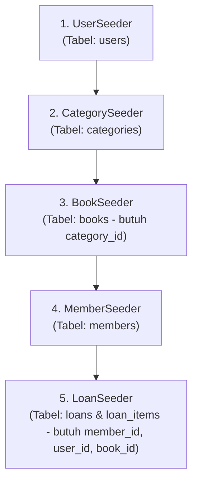

# Pertemuan 10: Integrasi Antarmuka Blade, Konsumsi Internal API, dan Finalisasi Data Proyek di Laravel 12

> **Informasi Modul:**
> - **Prasyarat:** Telah menyelesaikan Pertemuan 9 (perancangan RESTful API lengkap untuk entitas `books`, `members`, `loans`, dan `stats` dengan serialisasi JSON Resource).
> - **Fokus Pembelajaran:** Mengembangkan arsitektur *Backend for Frontend* (BFF) di mana aplikasi Laravel bertindak sebagai klien dari API internalnya sendiri menggunakan *Laravel HTTP Client* (`Http::get()`); menangani mitigasi *concurrency deadlock* pada server lokal melalui konfigurasi *dual server instances*; menyajikan data respons JSON ke dalam template Blade (`dashboard.blade.php` dan `loans/report.blade.php`); mengorkestrasikan data benih realistis ber-lokalisasi Indonesia menggunakan *Seeder* dan *Factory*; serta mengkustomisasi tampilan komponen paginasi.

---

## 1. Capaian Pembelajaran

Setelah menyelesaikan modul pertemuan ini, mahasiswa diharapkan mampu:
1. Memahami konsep arsitektur konsumsi API internal (*Service-to-Service call* / *Backend for Frontend*) serta prinsip pemisahan tanggung jawab (*Separation of Concerns*).
2. Menggunakan pustaka *Laravel HTTP Client* (`Illuminate\Support\Facades\Http`) untuk mengirim permintaan HTTP dan mengurai respons data JSON secara terstruktur.
3. Mengantisipasi kendala *single-threaded I/O deadlock* pada PHP built-in web server lokal melalui arsitektur server independen (*dual server instances*).
4. Menangani galat koneksi jaringan menggunakan blok `try/catch` terhadap `ConnectionException` untuk menjamin ketahanan antarmuka (*graceful degradation / fallback*).
5. Menyajikan data JSON terstruktur ke dalam antarmuka Blade dinamis pada halaman Dashboard dan Laporan Peminjaman Terpaginasi.
6. Mengembangkan data benih realistis berskala massal menggunakan *Seeder* dan *Factory* dengan lokalisasi bahasa Indonesia (`id_ID`) dan kurasi domain kampus.
7. Menyesuaikan tampilan komponen paginasi bawaan Laravel melalui `Paginator::defaultView()` agar konsisten dengan desain visual aplikasi.

---

## 2. Konsep Dasar Konsumsi API Internal dan Kendala Konkurensi

### 2.1 Mengapa Aplikasi Mengonsumsi API Miliknya Sendiri? (BFF & Pemisahan Tanggung Jawab)

Pada Pertemuan 9, RESTful API dibangun sebagai penyedia data tunggal (*Single Source of Truth*) yang mengembalikan format JSON netral untuk klien apa pun tanpa memandang bahasa atau platform yang digunakan.

Klien tersebut tidak terbatas pada aplikasi pihak ketiga (seperti aplikasi seluler Android/iOS atau *Single Page Application*). Aplikasi Laravel yang sama, melalui pengendali antarmuka web Blade, juga dapat bertindak sebagai **klien** dari API internalnya sendiri. Pendekatan ini dikenal dalam rekayasa perangkat lunak modern sebagai pola **BFF (*Backend for Frontend*)** atau komunikasi antarlayanan (*service-to-service communication*).

Mengapa kita memanggil API internal melalui protokol HTTP alih-alih langsung menjalankan kueri Eloquent (`Book::count()`) di dalam Controller web?
1. **Pemisahan Tanggung Jawab (*Separation of Concerns*):**  
   Pengendali antarmuka (`DashboardController`) tidak perlu mengetahui kompleksitas logika kueri basis data atau mekanisme *caching*. Pengendali hanya bertindak sebagai konsumen yang mengetahui kontrak data JSON dari endpoint `GET /api/stats`. Jika skema basis data berubah di kemudian hari, pengendali antarmuka tidak perlu dimodifikasi selama struktur kontrak JSON tetap konsisten.
2. **Kesiapan Arsitektur Layanan Terdistribusi (*Microservice Readiness*):**  
   Ketika antarmuka Blade terbukti mampu mengonsumsi data via HTTP, sistem siap sewaktu-waktu didekopling atau dipindahkan ke peladen mikro (*microservice*) terpisah tanpa mengubah satu baris pun logika tampilan Blade.

| Dimensi | Akses Langsung Eloquent ORM | Konsumsi Internal REST API via HTTP Client |
| :--- | :--- | :--- |
| **Kopling Logika (*Coupling*)** | Erat (*Tightly Coupled*) dengan skema database dan Model lokal. | Longgar (*Loosely Coupled*) berbasis kontrak payload data JSON. |
| **Lokasi Logika Bisnis** | Berpotensi terduplikasi antara Web Controller dan API Controller. | Terpusat satu pintu pada lapisan Controller & Resource API. |
| **Protokol Komunikasi** | Internal PHP memory / PDO driver database. | Protokol standar HTTP/HTTPS antarsistem. |
| **Fleksibilitas Integrasi** | Terbatas hanya di dalam runtime monolitik aplikasi itu sendiri. | Universal; data yang sama dapat dikonsumsi web, mobile, dan pihak ketiga. |

---

### 2.2 Fenomena *Single-Threaded Deadlock* pada `php artisan serve`

Dalam lingkungan pengembangan lokal, perintah `php artisan serve` memanfaatkan *PHP Built-in Web Server*. Server ini memiliki batasan arsitektur penting: **bersifat *single-threaded***, artinya hanya mampu memproses tepat **satu permintaan HTTP pada satu waktu**.

Kondisi kebuntuan (*deadlock*) akan terjadi jika sebuah permintaan antarmuka web memanggil API internal pada host dan port yang sama:

```text
Permintaan Masuk Browser (GET /)
               │
               ▼
+----------------------------------------------------+
| Server PHP Lokal: http://127.0.0.1:8000             |
| Status: SIBUK (Memproses Request 1: Dashboard)     |
+----------------------------------------------------+
               │
               │ DashboardController mengeksekusi:
               │ Http::get('http://127.0.0.1:8000/api/stats')
               ▼
+----------------------------------------------------+
| Server PHP Lokal: http://127.0.0.1:8000             |
| MENOLAK Request 2 karena masih sibuk di Request 1! |
+----------------------------------------------------+
               │
               ▼
[KONDISI DEADLOCK]: Request 1 menunggu balasan Request 2,
sedangkan Request 2 tidak dapat diproses sebelum Request 1 selesai.
Hasil: Halaman web menggantung (hang) hingga terjadi Request Timeout.
```

```text
SOLUSI ARSITEKTUR: MENJALANKAN DUA INSTANCE SERVER (DUAL-INSTANCE)

[Terminal 1 - Web Server UI]              [Terminal 2 - Dedicated API Server]
php artisan serve --port=8000             php artisan serve --port=8011
               │                                         │
               │ Request Browser (GET /)                 │
               ▼                                         │
    DashboardController                                  │
    Http::get('http://127.0.0.1:8011/api/stats')         │
               │                                         │
               └────────────────────────────────────────>│ Menerima & Memproses API
                                                         │ Status: 200 OK + JSON
               ┌─────────────────────────────────────────┤
               ▼                                         ▼
   Menerima Respons JSON                               Selesai
   Merender Blade Dashboard
```

> [!NOTE]
> Pada lingkungan produksi sesungguhnya (*production environment*), masalah *deadlock* ini tidak akan terjadi karena peladen web tingkat produksi (seperti Nginx + PHP-FPM atau Laravel Octane / Swoole) mengelola *process worker pool* multiproses dan menangani ribuan koneksi konkuren secara asinkron.

---

## 3. Fitur Inti Laravel HTTP Client, Seeder, dan Factory

### 3.1 Pemanfaatan `Illuminate\Support\Facades\Http`

Laravel menyediakan fasad `Http` sebagai pembungkus pustaka [Guzzle](https://docs.guzzlephp.org/) dengan sintaks yang sangat ekspresif:

```php
// Contoh sintaks dasar pemanggilan HTTP GET
use Illuminate\Support\Facades\Http;

$response = Http::get('http://127.0.0.1:8011/api/stats');
```

Objek kembalian `Illuminate\Http\Client\Response` menyediakan metode pemeriksaan yang tangguh:
- `$response->successful()`: Mengembalikan `true` jika kode status berada pada rentang sukses `2xx`.
- `$response->failed()`: Mengembalikan `true` jika kode status berada pada rentang galat `4xx` atau `5xx`.
- `$response->json()`: Mengurai badan respons JSON langsung menjadi array asosiatif PHP.

> [!IMPORTANT]
> **Pentingnya Menangkap `ConnectionException`:**  
> Metode `$response->successful()` hanya memvalidasi respons ketika peladen tujuan berhasil dihubungi. Jika peladen API internal belum aktif atau port salah, pemanggilan `Http::get()` akan melempar eksepsi fisik `Illuminate\Http\Client\ConnectionException`. Kode produksi yang baik wajib membungkus panggilan dengan blok `try/catch` agar antarmuka tidak mengalami galat fatal *500 Internal Server Error* ketika layanan API terputus.

```php
use Illuminate\Http\Client\ConnectionException;
use Illuminate\Support\Facades\Http;

try {
    $response = Http::get('http://127.0.0.1:8011/api/stats');
    $stats = $response->successful() ? $response->json() : $defaultStats;
} catch (ConnectionException $e) {
    $stats = $defaultStats; // Fallback data ketika server API mati
}
```

---

### 3.2 Seeder vs Factory: Strategi Pembangkitan Data Uji

Untuk kebutuhan pengujian sistem dan demonstrasi aplikasi (*Project Clinic / UAS*), database harus memuat data dummy yang realistis dalam jumlah representatif:

| Fitur | Seeder (`Illuminate\Database\Seeder`) | Model Factory (`Illuminate\Database\Eloquent\Factories\Factory`) |
| :--- | :--- | :--- |
| **Tujuan Utama** | Mengisi data master yang bernilai tetap, terstruktur, atau berurutan. | Membangkitkan kumpulan data acak (*random records*) dalam jumlah massal. |
| **Metode Kunci** | `Category::updateOrCreate(...)` | `Book::factory()->count(20)->create()` |
| **Pustaka Pendukung** | Logika PHP mandiri. | Terintegrasi dengan generator data acak **Faker**. |
| **Contoh Kasus** | Akun pengguna (`UserSeeder`), daftar kategori tetap (`CategorySeeder`). | Katalog 20 buku (`BookFactory`), 15 data mahasiswa (`MemberFactory`). |

#### Kurasi Data Indonesia vs Generator Default Faker
Secara bawaan, Faker menggunakan lokalisasi bahasa Inggris (`en_US`). Mengubah konfigurasi ke `APP_FAKER_LOCALE=id_ID` memastikan nama anggota, nomor telepon, dan alamat yang dihasilkan menggunakan konvensi Indonesia.

Namun, Faker tidak memiliki pustaka bawaan untuk judul buku atau nama penerbit lokal. Oleh karena itu, kita menerapkan teknik **kurasi terarah (*curated dataset*)**: mendefinisikan larik judul buku yang relevan per kategori sastra/sains/teknologi serta daftar penerbit resmi Indonesia, lalu memilihnya secara acak melalui `fake()->randomElement()`.

---

### 3.3 Orkestrasi Ketergantungan Foreign Key pada `DatabaseSeeder`

Urutan eksekusi seeder pada berkas `DatabaseSeeder.php` wajib memperhatikan integritas referensial kunci asing (*Foreign Key Constraints*):



Jika urutan ini tertukar (misalnya `BookSeeder` dieksekusi sebelum `CategorySeeder`), basis data akan melempar galat integritas relasi (*Foreign Key Constraint Violation*).

---

### 3.4 Kustomisasi Tampilan Paginasi Laravel (`Paginator::defaultView`)

Metode bawaan `{{ $books->links() }}` di Laravel mengasumsikan ketersediaan pustaka CSS Tailwind dengan ikon SVG. Pada proyek yang menggunakan *custom vanilla CSS*, ikon panah SVG bawaan Tailwind akan dirender dalam ukuran raksasa tanpa pembatas styling.

Alih-alih merombak berkas Blade satu per satu, Laravel memungkinkan pendaftaran tampilan paginasi global melalui metode `Paginator::defaultView('vendor.pagination.custom')` pada berkas `app/Providers/AppServiceProvider.php`. Seluruh pemanggilan `->links()` di seluruh proyek otomatis mengadopsi tampilan kustom yang bersih dan konsisten.

---

## 4. Langkah-Langkah Praktikum

> [!IMPORTANT]
> **Konteks Repositori:**  
> Praktikum ini melanjutkan repositori `app-perpustakaan` dari Pertemuan 9. Pastikan Anda berada pada cabang aktif `dev`.
>
> **Kebutuhan Terminal Ganda:**  
> Praktikum ini memerlukan dua terminal server lokal yang berjalan berdampingan:
> - **Server 1 (Antarmuka Web):** Berjalan pada port default `8000`.
> - **Server 2 (Dedicated API):** Berjalan pada port khusus `8011`.

Pastikan cabang aktif Anda adalah `dev` sebelum memulai pengerjaan:

```bash
git checkout dev
```

---

### Langkah 1: Konfigurasi Lingkungan Server Kedua Khusus API Internal

Buka berkas `.env` dan tambahkan variabel lingkungan `INTERNAL_API_URL` tepat di bawah konfigurasi `APP_URL`:

```bash
# File: .env (tambahkan setelah konfigurasi APP_URL)
INTERNAL_API_URL=http://127.0.0.1:8011
```

Perbarui juga berkas `.env.example` agar konfigurasi variabel ini terdokumentasi pada repositori publik:

```bash
# File: .env.example
INTERNAL_API_URL=http://127.0.0.1:8011
```

Daftarkan konfigurasi tersebut ke dalam berkas `config/services.php` sebelum tanda kurung siku penutup `];`:

```php
// File: config/services.php
    'internal_api' => [
        'base_url' => env('INTERNAL_API_URL', 'http://127.0.0.1:8011'),
    ],
];
```

---

### Langkah 2: Pembuatan `DashboardController`, Rute Dashboard, dan Antarmuka `dashboard.blade.php`

Buat pengendali baru untuk mengelola halaman beranda aplikasi:

```bash
php artisan make:controller DashboardController
```

Buka `app/Http/Controllers/DashboardController.php`. Implementasikan metode `index()` yang memanggil endpoint `GET /api/stats` dengan perlindungan `try/catch ConnectionException`:

```php
// File: app/Http/Controllers/DashboardController.php
<?php

namespace App\Http\Controllers;

use Illuminate\Http\Client\ConnectionException;
use Illuminate\Support\Facades\Http;

class DashboardController extends Controller
{
    /**
     * Menampilkan ringkasan statistik aplikasi dengan mengonsumsi GET /api/stats.
     */
    public function index()
    {
        $stats = [
            'total_buku' => 0,
            'total_anggota' => 0,
            'peminjaman_aktif' => 0,
        ];

        try {
            $response = Http::get(config('services.internal_api.base_url').'/api/stats');

            if ($response->successful()) {
                $stats = $response->json();
            }
        } catch (ConnectionException $e) {
            // Peladen API internal (port 8011) tidak dapat dihubungi - nilai fallback 0 digunakan.
        }

        return view('dashboard', compact('stats'));
    }
}
```

Buka `routes/web.php` dan perbarui rute beranda `/` yang sebelumnya hanya pengalihan (*redirect*) menjadi rute terproteksi menuju `DashboardController`:

```php
// File: routes/web.php
<?php

use App\Http\Controllers\AuthController;
use App\Http\Controllers\BookController;
use App\Http\Controllers\CategoryController;
use App\Http\Controllers\DashboardController;
use App\Http\Controllers\LoanController;
use App\Http\Controllers\MemberController;
use Illuminate\Support\Facades\Route;

// Rute Publik (Autentikasi Sesi)
Route::get('/login', [AuthController::class, 'showLogin'])->name('login');
Route::post('/login', [AuthController::class, 'login']);
Route::post('/logout', [AuthController::class, 'logout'])->name('logout');

// Rute Terproteksi Sesi (Middleware auth)
Route::middleware(['auth'])->group(function () {
    Route::get('/', [DashboardController::class, 'index'])->name('dashboard');

    Route::resource('books', BookController::class);
    Route::resource('members', MemberController::class);

    // Rute Laporan ditempatkan sebelum Resource Loans agar parameter {loan} tidak menimpa URI
    Route::get('/loans/report', [LoanController::class, 'report'])->name('loans.report');
    Route::resource('loans', LoanController::class);
    Route::put('/loans/{id}/kembalikan', [LoanController::class, 'kembalikan'])
        ->name('loans.kembalikan');

    // Rute Khusus Peran Administrator
    Route::middleware(['admin'])->group(function () {
        Route::resource('categories', CategoryController::class)->except(['show']);
    });
});
```

Buat berkas tampilan baru `resources/views/dashboard.blade.php`:

```html
<!-- File: resources/views/dashboard.blade.php -->
@extends('layouts.app')

@section('title', 'Dashboard Perpustakaan')

@section('content')
    <h1>Dashboard Utama</h1>
    <p>Ringkasan metrik statistik perpustakaan dikonsumsi langsung melalui endpoint internal <code>GET /api/stats</code>.</p>

    <div class="stats-grid">
        <div class="stat-card">
            <div class="value">{{ $stats['total_buku'] }}</div>
            <div class="label">Total Judul Buku</div>
        </div>
        <div class="stat-card">
            <div class="value">{{ $stats['total_anggota'] }}</div>
            <div class="label">Total Anggota Terdaftar</div>
        </div>
        <div class="stat-card">
            <div class="value">{{ $stats['peminjaman_aktif'] }}</div>
            <div class="label">Sirkulasi Peminjaman Aktif</div>
        </div>
    </div>

    <div style="margin-top: 28px;">
        <a href="{{ route('loans.report') }}" class="btn">Buka Laporan Sirkulasi &raquo;</a>
    </div>
@endsection
```

Tambahkan gaya CSS untuk kelas `.stats-grid` dan `.stat-card` pada blok `<style>` di dalam berkas `resources/views/layouts/app.blade.php`:

```css
/* File: resources/views/layouts/app.blade.php (di dalam tag <style>) */
.stats-grid { display: flex; gap: 20px; flex-wrap: wrap; margin-top: 20px; }
.stat-card { flex: 1; min-width: 180px; background: #f8fafc; border: 1px solid #e2e8f0; border-radius: 8px; padding: 22px; text-align: center; }
.stat-card .value { font-size: 36px; font-weight: bold; color: #1e3a8a; }
.stat-card .label { margin-top: 8px; color: #64748b; font-size: 14px; font-weight: 500; }
```

---

### Langkah 3: Integrasi Rute Laporan dan Metode `LoanController@report` serta Tampilan `loans/report.blade.php`

Buka berkas `app/Http/Controllers/LoanController.php`. Tambahkan impor kelas HTTP Client dan eksepsi koneksi di bagian atas:

```php
// File: app/Http/Controllers/LoanController.php
use Illuminate\Http\Client\ConnectionException;
use Illuminate\Support\Facades\Http;
```

Tambahkan metode `report(Request $request)` untuk mengonsumsi endpoint `GET /api/loans`:

```php
// File: app/Http/Controllers/LoanController.php
    /**
     * Menampilkan laporan transaksi peminjaman buku dari endpoint GET /api/loans.
     */
    public function report(Request $request)
    {
        $body = ['data' => [], 'meta' => null];

        try {
            $response = Http::get(config('services.internal_api.base_url').'/api/loans', [
                'page' => $request->query('page', 1),
            ]);

            if ($response->successful()) {
                $body = $response->json();
            }
        } catch (ConnectionException $e) {
            // Peladen API internal tidak merespons - tabel transaksi ditampilkan kosong.
        }

        return view('loans.report', [
            'loans' => $body['data'] ?? [],
            'meta'  => $body['meta'] ?? null,
        ]);
    }
```

Buat berkas antarmuka `resources/views/loans/report.blade.php`:

```html
<!-- File: resources/views/loans/report.blade.php -->
@extends('layouts.app')

@section('title', 'Laporan Sirkulasi Peminjaman')

@section('content')
    <h1>Laporan Transaksi Peminjaman</h1>
    <p>Data tabel di bawah ini dikonsumsi secara asinkron dari endpoint <code>GET /api/loans</code>.</p>

    <table>
        <thead>
            <tr>
                <th>ID Transaksi</th>
                <th>Nama Anggota</th>
                <th>Petugas Pencatat</th>
                <th>Daftar Buku</th>
                <th>Tgl Pinjam</th>
                <th>Batas Kembali</th>
                <th>Status Sirkulasi</th>
            </tr>
        </thead>
        <tbody>
            @forelse ($loans as $loan)
                <tr>
                    <td>#{{ $loan['id'] }}</td>
                    <td><strong>{{ $loan['member']['nama'] ?? '-' }}</strong></td>
                    <td>{{ $loan['petugas']['name'] ?? '-' }}</td>
                    <td>
                        @foreach ($loan['books'] as $book)
                            <span class="badge" style="background:#e0f2fe; color:#0369a1; padding:2px 6px; border-radius:4px; font-size:12px;">
                                {{ $book['judul'] }}
                            </span>@if (!$loop->last) @endif
                        @endforeach
                    </td>
                    <td>{{ $loan['tanggal_pinjam'] }}</td>
                    <td>{{ $loan['tanggal_kembali'] }}</td>
                    <td>
                        @if ($loan['status'] === 'dipinjam')
                            <span style="color:#d97706; font-weight:bold;">Dipinjam</span>
                        @elseif ($loan['status'] === 'dikembalikan')
                            <span style="color:#16a34a; font-weight:bold;">Dikembalikan</span>
                        @else
                            <span style="color:#dc2626; font-weight:bold;">{{ ucfirst($loan['status']) }}</span>
                        @endif
                    </td>
                </tr>
            @empty
                <tr>
                    <td colspan="7" style="text-align: center; color: #64748b;">Belum ada rekaman data peminjaman yang tersedia.</td>
                </tr>
            @endforelse
        </tbody>
    </table>

    @if ($meta && $meta['last_page'] > 1)
        <div class="pagination" style="margin-top: 20px;">
            @if ($meta['current_page'] > 1)
                <a href="{{ route('loans.report', ['page' => $meta['current_page'] - 1]) }}" class="btn" style="padding: 6px 12px;">&laquo; Sebelumnya</a>
            @endif
            
            <span>Halaman <strong>{{ $meta['current_page'] }}</strong> dari <strong>{{ $meta['last_page'] }}</strong> (Total {{ $meta['total'] }} Transaksi)</span>
            
            @if ($meta['current_page'] < $meta['last_page'])
                <a href="{{ route('loans.report', ['page' => $meta['current_page'] + 1]) }}" class="btn" style="padding: 6px 12px;">Selanjutnya &raquo;</a>
            @endif
        </div>
    @endif
@endsection
```

---

### Langkah 4: Pembaruan Alur Pengalihan Sesi Masuk (`AuthController@login`)

Buka berkas `app/Http/Controllers/AuthController.php`. Arahkan pengalihan pengguna setelah autentikasi berhasil ke rute `dashboard` alih-alih `books.index`:

```php
// File: app/Http/Controllers/AuthController.php (pada metode login)
        return redirect()->intended(route('dashboard'))
            ->with('success', 'Autentikasi berhasil. Selamat datang kembali, ' . Auth::user()->name . '.');
```

---

### Langkah 5: Pembaruan Bilah Navigasi Dinamis (`partials/navbar.blade.php`)

Buka `resources/views/partials/navbar.blade.php`. Tambahkan tautan navigasi **Dashboard** di awal menu dan **Laporan** di akhir menu peminjaman:

```html
<!-- File: resources/views/partials/navbar.blade.php -->
<nav>
    <div class="brand">📚 Perpustakaan Digital Kampus</div>
    @auth
        <ul>
            <li><a href="{{ route('dashboard') }}" class="{{ request()->routeIs('dashboard') ? 'active' : '' }}">Dashboard</a></li>
            <li><a href="{{ route('books.index') }}" class="{{ request()->routeIs('books.*') ? 'active' : '' }}">Katalog Buku</a></li>
            @if (auth()->user()->role === 'admin')
                <li><a href="{{ route('categories.index') }}" class="{{ request()->routeIs('categories.*') ? 'active' : '' }}">Kategori</a></li>
            @endif
            <li><a href="{{ route('members.index') }}" class="{{ request()->routeIs('members.*') ? 'active' : '' }}">Anggota</a></li>
            <li><a href="{{ route('loans.index') }}" class="{{ request()->routeIs('loans.index') || request()->routeIs('loans.create') || request()->routeIs('loans.show') || request()->routeIs('loans.edit') ? 'active' : '' }}">Sirkulasi</a></li>
            <li><a href="{{ route('loans.report') }}" class="{{ request()->routeIs('loans.report') ? 'active' : '' }}">Laporan</a></li>
        </ul>
        <div class="navbar-user">
            <span>{{ auth()->user()->name }} ({{ ucfirst(auth()->user()->role) }})</span>
            <form action="{{ route('logout') }}" method="POST" class="inline">
                @csrf
                <button type="submit" class="btn-logout">Logout</button>
            </form>
        </div>
    @endauth
    @guest
        <a href="{{ route('login') }}" class="{{ request()->routeIs('login') ? 'active' : '' }}">Login Portal</a>
    @endguest
</nav>
```

---

### Langkah 6: Implementasi Seeder & Factory Berlokalisasi Indonesia

Atur lokalisasi Faker pada berkas `.env` dan `.env.example`:

```bash
# File: .env dan .env.example
APP_FAKER_LOCALE=id_ID
```

Pastikan model `Book` dan `Member` menyertakan trait `HasFactory`:

```php
// File: app/Models/Book.php
namespace App\Models;

use Illuminate\Database\Eloquent\Factories\HasFactory;
use Illuminate\Database\Eloquent\Model;

class Book extends Model
{
    use HasFactory;
    // ...
```

```php
// File: app/Models/Member.php
namespace App\Models;

use Illuminate\Database\Eloquent\Factories\HasFactory;
use Illuminate\Database\Eloquent\Model;

class Member extends Model
{
    use HasFactory;
    // ...
```

Buat berkas seeder dan factory yang dibutuhkan:

```bash
php artisan make:seeder CategorySeeder
php artisan make:seeder BookSeeder
php artisan make:factory BookFactory --model=Book
php artisan make:seeder MemberSeeder
php artisan make:factory MemberFactory --model=Member
php artisan make:seeder LoanSeeder
```

#### 1. Implementasi `CategorySeeder.php`
Buka `database/seeders/CategorySeeder.php`:

```php
// File: database/seeders/CategorySeeder.php
<?php

namespace Database\Seeders;

use App\Models\Category;
use Illuminate\Database\Seeder;

class CategorySeeder extends Seeder
{
    public function run(): void
    {
        $categories = [
            ['nama_kategori' => 'Novel', 'deskripsi' => 'Karya sastra fiksi naratif dengan alur dan karakter kompleks.'],
            ['nama_kategori' => 'Komik', 'deskripsi' => 'Buku cerita bergambar dan ilustrasi visual interaktif.'],
            ['nama_kategori' => 'Sains', 'deskripsi' => 'Buku ilmu pengetahuan alam, matematika, dan penelitian ilmiah.'],
            ['nama_kategori' => 'Teknologi', 'deskripsi' => 'Literatur rekayasa perangkat lunak, informatika, dan siber.'],
            ['nama_kategori' => 'Sejarah', 'deskripsi' => 'Dokumentasi peristiwa peradaban bangsa dan tokoh perjuangan.'],
        ];

        foreach ($categories as $category) {
            Category::updateOrCreate(
                ['nama_kategori' => $category['nama_kategori']],
                $category
            );
        }
    }
}
```

#### 2. Implementasi `BookFactory.php` dan `BookSeeder.php`
Buka `database/factories/BookFactory.php` dengan judul dan penerbit terkurasi:

```php
// File: database/factories/BookFactory.php
<?php

namespace Database\Factories;

use App\Models\Category;
use Illuminate\Database\Eloquent\Factories\Factory;

/**
 * @extends Factory<\App\Models\Book>
 */
class BookFactory extends Factory
{
    protected array $judulPerKategori = [
        'Novel' => [
            'Laskar Pelangi', 'Bumi Manusia', 'Negeri 5 Menara', 'Ronggeng Dukuh Paruk',
            'Ayat-Ayat Cinta', 'Pulang', 'Cantik Itu Luka', 'Sang Pemimpi',
            'Perahu Kertas', 'Gadis Kretek', 'Amba', 'Saman',
        ],
        'Komik' => [
            'Si Juki: Kuliah Kerja Nyata', 'Garudayana', 'Wonder Wayang', 'Tuti and Friends',
            'Grojogan Sewu', 'Petualangan Panji', 'Nusantaranger', 'Kabayan City',
        ],
        'Sains' => [
            'Pengantar Fisika Dasar', 'Kimia Organik untuk Pemula', 'Biologi Sel dan Molekuler',
            'Astronomi: Menjelajah Alam Semesta', 'Ekologi dan Lingkungan Hidup',
            'Genetika Modern', 'Dasar-Dasar Termodinamika',
        ],
        'Teknologi' => [
            'Dasar Pemrograman dengan PHP', 'Algoritma dan Struktur Data', 'Jaringan Komputer Modern',
            'Kecerdasan Buatan untuk Pemula', 'Pengantar Basis Data Relasional', 'Rekayasa Perangkat Lunak',
            'Keamanan Siber Praktis',
        ],
        'Sejarah' => [
            'Sejarah Indonesia Modern', 'Proklamasi dan Perjuangan Bangsa', 'Jejak Kerajaan Nusantara',
            'Revolusi Indonesia 1945-1949', 'Perang Diponegoro', 'Sejarah Perdagangan Rempah',
            'Jalur Sutra dan Nusantara',
        ],
    ];

    protected array $daftarPenerbit = [
        'Gramedia Pustaka Utama', 'Mizan', 'Bentang Pustaka', 'Kepustakaan Populer Gramedia',
        'Balai Pustaka', 'Erlangga', 'Andi Publisher', 'Informatika Bandung',
        'Elex Media Komputindo', 'Rajawali Pers', 'Republika Penerbit', 'Kompas Media Nusantara',
    ];

    public function definition(): array
    {
        $category = Category::inRandomOrder()->first();
        $poolJudul = $this->judulPerKategori[$category?->nama_kategori] ?? $this->judulPerKategori['Novel'];

        return [
            'judul'        => fake()->randomElement($poolJudul),
            'penulis'      => fake()->name(),
            'penerbit'     => fake()->randomElement($this->daftarPenerbit),
            'tahun_terbit' => fake()->numberBetween(1995, (int) date('Y')),
            'isbn'         => fake()->unique()->isbn13(),
            'stok'         => fake()->numberBetween(2, 12),
            'category_id'  => $category?->id,
        ];
    }
}
```

Buka `database/seeders/BookSeeder.php`:

```php
// File: database/seeders/BookSeeder.php
<?php

namespace Database\Seeders;

use App\Models\Book;
use Illuminate\Database\Seeder;

class BookSeeder extends Seeder
{
    public function run(): void
    {
        Book::factory()->count(20)->create();
    }
}
```

#### 3. Implementasi `MemberFactory.php` dan `MemberSeeder.php`
Buka `database/factories/MemberFactory.php` dengan format email kampus `@pens.ac.id`:

```php
// File: database/factories/MemberFactory.php
<?php

namespace Database\Factories;

use Illuminate\Database\Eloquent\Factories\Factory;
use Illuminate\Support\Str;

/**
 * @extends Factory<\App\Models\Member>
 */
class MemberFactory extends Factory
{
    public function definition(): array
    {
        $nama = fake()->firstName().' '.fake()->lastName();

        return [
            'nama'          => $nama,
            'nim'           => fake()->unique()->numerify('3123500###'),
            'email'         => Str::slug($nama, '.').fake()->unique()->numerify('##').'@pens.ac.id',
            'nomor_telepon' => fake()->numerify('0812########'),
            'alamat'        => fake()->address(),
            'status'        => fake()->randomElement(['aktif', 'aktif', 'aktif', 'nonaktif']),
        ];
    }
}
```

Buka `database/seeders/MemberSeeder.php`:

```php
// File: database/seeders/MemberSeeder.php
<?php

namespace Database\Seeders;

use App\Models\Member;
use Illuminate\Database\Seeder;

class MemberSeeder extends Seeder
{
    public function run(): void
    {
        Member::factory()->count(15)->create();
    }
}
```

#### 4. Implementasi `LoanSeeder.php`
Buka `database/seeders/LoanSeeder.php` untuk menghasilkan 10 transaksi peminjaman acak yang valid:

```php
// File: database/seeders/LoanSeeder.php
<?php

namespace Database\Seeders;

use App\Models\Book;
use App\Models\Loan;
use App\Models\Member;
use App\Models\User;
use Illuminate\Database\Seeder;

class LoanSeeder extends Seeder
{
    public function run(): void
    {
        $memberIds = Member::pluck('id');
        $userIds = User::pluck('id');
        $bookIds = Book::pluck('id');

        for ($i = 0; $i < 10; $i++) {
            $tanggalPinjam = now()->subDays(fake()->numberBetween(1, 25));
            $tanggalKembali = $tanggalPinjam->copy()->addDays(7);
            $status = fake()->randomElement(['dipinjam', 'dikembalikan', 'dikembalikan', 'terlambat']);

            $loan = Loan::create([
                'member_id'            => $memberIds->random(),
                'user_id'              => $userIds->random(),
                'tanggal_pinjam'       => $tanggalPinjam->toDateString(),
                'tanggal_kembali'      => $tanggalKembali->toDateString(),
                'tanggal_dikembalikan' => $status === 'dikembalikan'
                    ? $tanggalKembali->copy()->subDays(fake()->numberBetween(0, 3))->toDateString()
                    : null,
                'status'               => $status,
            ]);

            $selectedBooks = $bookIds->random(fake()->numberBetween(1, min(3, $bookIds->count())));
            foreach ($selectedBooks as $bookId) {
                $loan->loanItems()->create(['book_id' => $bookId]);
            }
        }
    }
}
```

#### 5. Pembaruan Identitas Realistis pada `UserSeeder.php`
Buka `database/seeders/UserSeeder.php` dan perbarui atribut `name` pengguna awal:

```php
// File: database/seeders/UserSeeder.php (perbarui nama pengguna default)
        User::updateOrCreate(
            ['email' => 'admin@pens.ac.id'],
            ['name' => 'Bambang Sutrisno', 'password' => Hash::make('password'), 'role' => 'admin']
        );

        User::updateOrCreate(
            ['email' => 'petugas1@pens.ac.id'],
            ['name' => 'Siti Rahmawati', 'password' => Hash::make('password'), 'role' => 'petugas']
        );

        User::updateOrCreate(
            ['email' => 'petugas2@pens.ac.id'],
            ['name' => 'Ahmad Fauzi', 'password' => Hash::make('password'), 'role' => 'petugas']
        );
```

#### 6. Orkestrasi Terpadu pada `DatabaseSeeder.php`
Buka `database/seeders/DatabaseSeeder.php` dan susun pemanggilan seeder berdasarkan urutan ketergantungan relasi:

```php
// File: database/seeders/DatabaseSeeder.php
<?php

namespace Database\Seeders;

use Illuminate\Database\Seeder;

class DatabaseSeeder extends Seeder
{
    /**
     * Seed the application's database.
     */
    public function run(): void
    {
        $this->call([
            UserSeeder::class,
            CategorySeeder::class,
            BookSeeder::class,
            MemberSeeder::class,
            LoanSeeder::class,
        ]);
    }
}
```

---

### Langkah 7: Perbaikan dan Kustomisasi Tampilan Komponen Paginasi

Buat direktori penyimpanan template paginasi kustom:

```bash
mkdir -p resources/views/vendor/pagination
```

Buat berkas template baru `resources/views/vendor/pagination/custom.blade.php`:

```html
<!-- File: resources/views/vendor/pagination/custom.blade.php -->
@if ($paginator->hasPages())
    <nav class="pagination">
        {{-- Tautan Halaman Sebelumnya --}}
        @if ($paginator->onFirstPage())
            <span class="pagination-disabled">&laquo; Sebelumnya</span>
        @else
            <a href="{{ $paginator->previousPageUrl() }}">&laquo; Sebelumnya</a>
        @endif

        {{-- Nomor Halaman Numerik --}}
        @foreach ($paginator->getUrlRange(1, $paginator->lastPage()) as $page => $url)
            @if ($page == $paginator->currentPage())
                <span class="pagination-current">{{ $page }}</span>
            @else
                <a href="{{ $url }}">{{ $page }}</a>
            @endif
        @endforeach

        {{-- Tautan Halaman Berikutnya --}}
        @if ($paginator->hasMorePages())
            <a href="{{ $paginator->nextPageUrl() }}">Berikutnya &raquo;</a>
        @else
            <span class="pagination-disabled">Berikutnya &raquo;</span>
        @endif
    </nav>
@endif
```

Daftarkan template ini sebagai penyaji paginasi default pada berkas `app/Providers/AppServiceProvider.php`:

```php
// File: app/Providers/AppServiceProvider.php
<?php

namespace App\Providers;

use Illuminate\Pagination\Paginator;
use Illuminate\Support\ServiceProvider;

class AppServiceProvider extends ServiceProvider
{
    public function register(): void
    {
        //
    }

    public function boot(): void
    {
        Paginator::defaultView('vendor.pagination.custom');
    }
}
```

Tambahkan gaya CSS paginasi pada blok `<style>` di `resources/views/layouts/app.blade.php`:

```css
/* File: resources/views/layouts/app.blade.php (di dalam tag <style>) */
.pagination { margin-top: 18px; display: flex; gap: 12px; align-items: center; flex-wrap: wrap; }
.pagination a { color: #2563eb; text-decoration: none; font-weight: 500; }
.pagination a:hover { text-decoration: underline; }
.pagination .pagination-current { font-weight: bold; color: #1e3a8a; background: #e2e8f0; padding: 2px 8px; border-radius: 4px; }
.pagination .pagination-disabled { color: #94a3b8; cursor: not-allowed; }
```

---

### Langkah 8: Pengujian Menyeluruh Sistem Menggunakan Dua Server Lokal

Jalankan migrasi ulang dan eksekusi seeder dari awal:

```bash
php artisan migrate:fresh --seed
```

Buka **dua jendela terminal terpisah**:
- **Terminal 1 (Aplikasi Web Utama):**
  ```bash
  php artisan serve --port=8000
  ```
- **Terminal 2 (Dedicated Internal API):**
  ```bash
  php artisan serve --port=8011
  ```

Lakukan skenario pengujian komprehensif:
1. Akses `http://127.0.0.1:8000/login` dan autentikasi dengan akun admin:
   - Email: `admin@pens.ac.id`
   - Password: `password`
2. Pastikan setelah login berhasil, sistem mengalihkan halaman ke **Dashboard Utama** (`/`), dan identitas "Bambang Sutrisno (Admin)" tampil di bilah navigasi.
3. Verifikasi kartu statistik Dashboard memuat angka riil: Total Buku (`20`), Total Anggota (`15`), dan Sirkulasi Peminjaman Aktif sesuai data seeding.
4. Buka menu **Katalog Buku** (`/books`) dan **Anggota** (`/members`): pastikan paginasi di bawah tabel tampil rapi berupa tautan nomor halaman dan tombol `« Sebelumnya` / `Berikutnya »`.
5. Klik menu **Laporan** (`/loans/report`): pastikan 10 transaksi peminjaman tampil lengkap beserta daftar buku relasi dan paginasi data.
6. **Uji Ketahanan Sambungan Jaringan (*Fallback Verification*):**
   Hentikan proses di Terminal 2 (port `8011`) dengan `Ctrl+C`. Buka kembali halaman Dashboard dan Laporan. Pastikan kedua halaman tetap dapat diakses tanpa galat *500 Internal Server Error* (kartu statistik bernilai `0` dan tabel laporan menampilkan pesan kosong yang informatif).

---

## 5. Checkpoint Git Praktikum

Setelah menyelesaikan seluruh langkah di atas dan memastikan sistem berfungsi sempurna, simpan seluruh perubahan kode ke repositori lokal dan unggah ke cabang pengembangan `dev`:

```bash
git status
git add .
git commit -m "[P-10] dashboard laporan seeder factory dan finalisasi project"
git push origin dev
```

---

## 6. Tugas Mandiri dan Finalisasi Proyek Pra-UAS

Seluruh fitur teknis fungsional aplikasi `app-perpustakaan` telah lengkap dibangun. Tugas mandiri pertemuan ini berfokus pada persiapan demonstrasi evaluasi proyek:

1. **Penggabungan Cabang (*Merge to Main*):**  
   Lakukan penggabungan cabang kerja `dev` ke cabang produksi `main` untuk memastikan repositori siap dievaluasi.
2. **Penyusunan Berkas Skenario Demo (`DEMO.md`):**  
   Buat berkas panduan teknis `DEMO.md` di direktori utama repositori yang merinci urutan alur pengujian saat presentasi:
   - Skenario Masuk (*Login*) Admin dan Petugas.
   - Penjelajahan Dashboard dan Statistik Metrik.
   - Manajemen Sumber Daya CRUD (Kategori, Buku, Anggota).
   - Sirkulasi Transaksi Peminjaman dan Pengembalian Buku.
   - Konsumsi Laporan Sirkulasi Internal API.
   - Pengujian Koleksi RESTful API pada Postman.
3. **Pembaruan Dokumentasi Utama (`README.md`):**  
   Perbarui berkas `README.md` dengan panduan instalasi lengkap proyek (kloning repositori, instalasi dependensi Composer, penyiapan konfigurasi `.env` termasuk `INTERNAL_API_URL`, eksekusi `migrate:fresh --seed`, dan panduan menjalankan *dual-server instance*).

**Keluaran Tugas:**
- Tautan komit penggabungan (*merge commit*) pada cabang `main` di repositori GitHub.
- Berkas dokumentasi `DEMO.md`.
- Berkas dokumentasi instalasi proyek `README.md`.

---

## Navigasi Modul
- [← Pertemuan 09: RESTful API Dasar dan Format Respons JSON di Laravel 12](./pertemuan-09.md)
- [Daftar Isi Modul](./README.md)
- [Pertemuan 11: Evaluasi Proyek dan Presentasi UAS](./pertemuan-11.md) &rarr;
